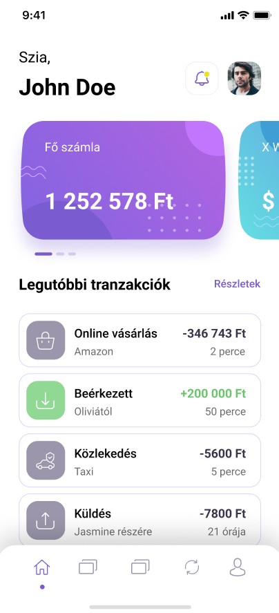
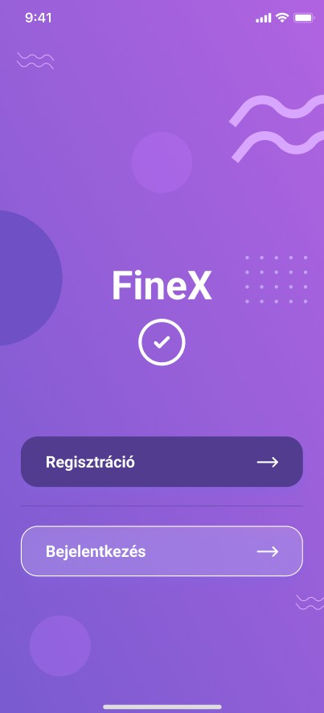

## FineX – digitális bankalkalmazás (fejlesztés alatt)

Spring Boot REST API és React webes felület: felhasználók, bankszámlák, bankkártyák, átutalások, megtakarítások, statisztikák, értesítések és ügyfélszolgálat – biztonságosan, tesztelten, modern felülettel.

### 📁 Projekt felépítése

| Mappa | Tartalom | Fejlesztőeszköz |
|---|---|---|
| [`backend/`](backend) | Spring Boot REST API (Java 17, Maven) | Eclipse / Spring Tool Suite |
| [`frontend/`](frontend) | React + TypeScript webes felület (Vite, Tailwind CSS) | VS Code |
| [`database/`](database) | PostgreSQL (Docker Compose), a séma és a demóadatok leírása | Docker Desktop, pgAdmin |
| [`docs/`](docs) | [Telepítési útmutató](docs/TELEPITES.md), UI koncepcióképek | – |

---

### 🔧 Technológiák

**Backend**
- Java 17, Spring Boot 3.5.16, Maven
- Spring Web, Spring Data JPA (Hibernate), Jakarta Validation, Lombok
- Spring Security, JWT alapú autentikáció
- Swagger UI (Springdoc OpenAPI)
- Ütemezett feladatok (Spring Scheduling)

**Adatbázis**
- PostgreSQL 15 (Docker Compose)
- Flyway – verziózott adatbázis-migrációk (a Hibernate csak ellenőriz: `ddl-auto=validate`)

**Frontend**
- React 19, TypeScript, Vite
- Tailwind CSS 4 – saját design system, világos és sötét mód
- React Router (oldalanként betöltődő kód), TanStack Query (szerveradatok gyorsítótárazása), axios
- React Hook Form + Zod (űrlapok és validáció)
- Motion (animációk), Sonner (értesítő buborékok), Lucide ikonok

**Tesztelés**
- JUnit 5, Mockito, Spring Boot Test / MockMvc, `@WebMvcTest` controller slice tesztek
- Testcontainers + PostgreSQL (repository-, adatbázisszabály- és integrációs tesztek)
- Vitest + Testing Library (frontend: segédfüggvények, űrlapszabályok, az utalási varázsló teljes folyamata)

**Futtatás**
- Docker Compose: adatbázis + backend + nginx-szel kiszolgált frontend egy paranccsal

---

## 🚀 Indítás egy paranccsal (Docker)

Csak a Docker Desktop kell (Java és Node.js nem). A `FineX` mappában:

```bash
docker compose up -d --build --wait
```

Az első alkalommal több percig tart (letölti és lefordítja a backendet és a frontendet), utána: **http://localhost:3000**
(Swagger UI: http://localhost:3000/api/swagger-ui.html). Leállítás: `docker compose down` – az adatok megmaradnak.
Részletek: [`docs/TELEPITES.md`](docs/TELEPITES.md#8-indítás-egy-paranccsal-docker-compose).

## 🚀 Indítás (fejlesztői környezet)

Szükséges: Git, Docker Desktop, JDK 21 (17 vagy újabb), Node.js 24 LTS (legalább 22.12).
Új gépen lépésről lépésre (letöltések, Eclipse, hibaelhárítás): **[`docs/TELEPITES.md`](docs/TELEPITES.md)**.

1. **Adatbázis** – a `database` mappában:
   ```bash
   docker compose up -d
   ```
2. **Backend** – Eclipse-ben a `FinexApplication` futtatásával, vagy a `backend` mappában:
   ```bash
   ./mvnw spring-boot:run
   ```
   (Windows PowerShellben: `.\mvnw.cmd spring-boot:run`.) Az első induláskor a Flyway létrehozza a sémát és betölti a demóadatokat.
   API: http://localhost:8080 · Swagger UI: http://localhost:8080/swagger-ui.html
3. **Frontend** – a `frontend` mappában:
   ```bash
   npm install
   npm run dev
   ```
   Webes felület: http://localhost:5173 (a `/api/...` kéréseket a Vite továbbítja a backendnek).

A demó felhasználók belépési adatai a [`database/README.md`](database/README.md#demó-felhasználók) fájlban vannak.

---

## 📌 Projekt leírás
Saját projekt, ahol egy digitális bank backendjét és webes felületét építem fel modulárisan, Spring Boot és React segítségével.
A projekt célja, hogy **valós banki funkciókat** modellezzek és gyakoroljak (felhasználók, bankszámlák, bankkártyák, tranzakciók, megtakarítások, átutalások, ügyfélszolgálat).

---

## ✅ Megvalósított funkciók (backend)
### Alapok
- Spring Boot alapkonfiguráció
- PostgreSQL adatbázis
- Hibernate + JPA
- Flyway-migrációk: séma, `CHECK` megszorítások, részleges indexek, a könyvelt tételeket védő trigger, SQL-függvények és nézet (részletek: [`database/README.md`](database/README.md))
- Demóadatok (felhasználók, számlák, kártyák, fél év tranzakció, megtakarítások)
- Auditing (`createdAt`, `updatedAt`)
- Globális exception handling
- Ütemezett feladatok (havi kamatjóváírás, rendszeres átutalások)
- Az üzleti szabályok paraméterei egy helyen (`finex.*`: napi utalási limit, nyitható számlák száma, kamatláb, kártyalimitek); a frontend a `GET /settings` végpontról olvassa őket, nincs saját másolata

### Biztonság
- JWT alapú autentikáció, stateless SecurityConfig; a jogosultságot a szerver minden kérésnél az adatbázisból veszi
- Visszavonható tokenek: kijelentkezéskor a token tiltólistára kerül; jelszócsere, letiltás, szerepkör-változás és
  „kijelentkezés minden eszközről” után a felhasználó összes korábbi tokenje érvénytelen (tokenverzió)
- A JWT-kulcs csak környezeti változóból jöhet (legalább 32 bájt); ha nincs megadva, minden indításkor véletlen kulcs készül
- Védett endpointok, User / Admin szerepkörök, admin végpontok; minden felhasználó csak a saját adatait látja és módosíthatja
- Belépési napló és háromszintű zárolás: e-mail + IP (5 hiba), fiók (20 hiba), IP-cím (20 hiba); egyforma válaszidő
  létező és nem létező fióknál (a fiókok nem találgathatók ki)
- Kérésszám-korlát (belépés percenként, regisztráció óránként, IP-címenként; `429` + `Retry-After`) és kérésméret-korlát
- E-mail-cím módosításához a jelenlegi jelszó kell; jelszó legfeljebb 72 bájt (a BCrypt határa)
- Bemeneti korlátok mindenhol (szöveghossz, összeg számjegyei, oldalméret legfeljebb 100, lekérdezési időszak legfeljebb 366 nap)
- Biztonsági fejlécek (CSP, `X-Frame-Options`, `Referrer-Policy`, `Permissions-Policy`), a frontendben nincs inline script
- Éles profil (`prod`): nincsenek demóadatok és Swagger, és az indulás megtagadva, ha nincs JWT-kulcs vagy maradt demófiók
- Admin audit napló: minden admin művelet (státusz- és szerepkörváltás, befizetés, sztornó, kategóriák, ticketek,
  kézi ütemezőfuttatás) visszamenőleg nem módosítható naplóba kerül

### Felhasználók
- Regisztráció (automatikus folyószámlával és bankkártyával)
- Bejelentkezés
- Saját profil lekérdezése és módosítása, jelszócsere

### Bankszámlák
- Folyószámlák kezelése
- Devizanemek (HUF, EUR, USD)
- Egyenleg kezelés
- Státuszok (ACTIVE, BLOCKED, FROZEN, CLOSED)
- Számlakivonat futó egyenleggel, letöltés CSV-ben (Excelben is jól nyílik, CSV-injekció ellen védve)
- Devizaváltás a saját számlák között (rögzített demóárfolyamokkal)
- Készpénzbefizetés csak admin által (az ügyfél nem írhat jóvá magának pénzt)

### Bankkártyák
- Kártya minden számlához
- Tiltás / feloldás, napi limit, online fizetés engedélyezése
- Kártyás fizetés (demó)

### Tranzakciók
- Bevétel / kiadás
- Számlák közötti átutalás (napi limittel – devizás számlánál forintértékben –, fedezetellenőrzéssel, párhuzamos utalásoknál is konzisztensen)
- Idempotencia-kulcs az utalásnál, devizaváltásnál és kártyás fizetésnél: dupla kattintás vagy hálózati újraküldés
  sem könyvel kétszer
- Sztornó (admin): a hibás tétel nem törlődik, hanem egy ellentétes tétel hivatkozik rá; egy tétel csak egyszer sztornózható
- Egyeztetés: SQL-nézet ellenőrzi, hogy minden számla egyenlege megegyezik-e a tranzakcióinak összegével (admin áttekintés)
- Kimenő és bejövő tranzakciók, az utalás két lába összekapcsolva
- Egyenleg history (BalanceHistory)
- Szűrés időszak, összeg, típus, kategória és szöveg szerint
- Tranzakció kategóriák
- Kedvezményezettek, rendszeres átutalások

### Megtakarítások
- Megtakarítási számlák célösszeggel
- Pénz áthelyezése folyószámla ↔ megtakarítás
- Havi kamatjóváírás az előző hónap legalacsonyabb egyenlege után (hónap végi befizetéssel nem játszható ki), havonta egyszer

### Statisztikák és értesítések
- Főoldal összesítő, havi bevétel/kiadás, költés kategóriánként, legnagyobb kiadások (a saját számlák közötti
  mozgások, devizaváltások és sztornók nem torzítják)
- Értesítések (beérkező utalás, biztonsági események, ügyfélszolgálati válasz)

### Ügyfélszolgálat
- Support ticket rendszer
- Ticket nyitás csak bejelentkezett felhasználóknak
- Ticket státuszkezelés
- Üzenetváltás a ticketen belül (admin válasz)

---

## 🖥️ Webes felület (React)

A frontend öt részben készült:

- [x] **1. Alapok** – design system (lila márkaszín, világos / sötét / rendszer téma), animált belépés és regisztráció, alkalmazáskeret (oldalsáv, felső sáv, mobilos alsó menü), munkamenet-kezelés (JWT, lejáratkor automatikus kiléptetés), szerepkör alapú útvonalvédelem
- [x] **2. Főoldal, számlák, bankkártyák** – egyenlegösszesítő és havi bevétel/kiadás grafikon, számlanyitás és -lezárás, számlaadatlap egyenleggrafikonnal és kivonattal (futó egyenleg), kártyatiltás, napi limit, online fizetés, demó kártyás fizetés
- [x] **3. Pénzmozgás** – kereshető, szűrhető tranzakciólista (a szűrés a címsorban marad) tételadatlappal és kategorizálással, utalás lépésről lépésre nyugtával, kedvezményezettek, rendszeres átutalások
- [x] **4. Tervezés** – megtakarítási célok körkörös haladásjelzővel (befizetés, kivét, mozgások, havi kamat, lezárás), statisztika időszak- és pénznemválasztóval (bevétel, kiadás, megtakarítási arány, havi grafikon, költés kategóriánként, legnagyobb kiadások)
- [x] **5. Fiók és adminisztráció** – értesítések (szűrés, napok szerint csoportosítva, olvasottnak jelölés), profil és biztonság (személyes adatok, jelszócsere, belépési előzmények, téma), ügyfélszolgálat csevegő nézetben, admin felület (áttekintés és ütemezett feladatok kézi indítása, felhasználók, számlák, ticketek, belépési napló, kategóriák)

Mindenhol elérhető: **Ctrl + K** parancspaletta (oldalak, számlák, kedvezményezettek, gyorsműveletek keresése), mobilon alulról nyíló és lehúzással bezárható ablakok, a kattintás helyéről körben szétterülő témaváltás.

A kód felépítése (`frontend/src`):

| Mappa | Tartalom |
|---|---|
| `app/` | Útvonalak, az alkalmazás kerete (oldalsáv, fejléc, alsó menü), menüszerkezet |
| `features/` | Oldalak funkciónként (`pages/`, `components/`, `queries.ts`, `schemas.ts`): számlák, kártyák, utalás, statisztika, admin, … |
| `components/` | Újrahasznosítható UI-elemek (`ui/`), márkaelemek (`brand/`), töltés közbeni vázak (`skeletons/`), grafikonelemek (`charts/`) |
| `api/` | Backend-hívások és a DTO-k TypeScript típusai |
| `session/` | Munkamenet (token, lejárat) és útvonalvédők |
| `theme/` | Világos / sötét mód |
| `lib/`, `hooks/` | Segédfüggvények, közös animációk |

---

## 🧪 Tesztelés

- 512 automatizált backend teszt – futtatás a `backend` mappában: `./mvnw test` (a Testcontainers miatt a Dockernek futnia kell)
- Unit tesztek (mapperek, service-ek Mockitóval)
- Controller slice tesztek (@WebMvcTest)
- Repository és adatbázis-szabály tesztek **Testcontainers + PostgreSQL** segítségével (triggerek, egyedi indexek,
  sztornó, egyeztető nézetek, kamat minimumegyenleg alapján)
- Biztonsági tesztek: hamisított / `alg=none` / visszavont / régi verziójú token, zárolás, kérésszám-korlát, idempotencia
- Párhuzamos utalások integrációs tesztje (a számla nem mehet mínuszba)
- A tesztek **külön, izolált adatbázist** használnak (Docker container)
- Frontend: 19 Vitest teszt (`npm test`) – IBAN-ellenőrzés, összegfeldolgozás, űrlapszabályok, és az utalási varázsló
  teljes folyamata (a dupla kattintás sem küld két utalást); TypeScript típusellenőrzés és ESLint (`npm run build`, `npm run lint`)

---

## 🚧 Tervezett funkciók

### Megtakarítások
- Automatikus havi megtakarítás

---

## Tervezett mobilalkalmazás (SwiftUI – WIP)

A Finex backendhez egy **natív iOS mobilbanki alkalmazás** készül SwiftUI technológiával.  
Az alkalmazás célja, hogy a backend funkcióit egy **modern, letisztult mobilbanki felületen** tegye elérhetővé.

⚠️ **Megjegyzés:**  
Az alábbi UI képek és leírások **koncepciótervek**, a végleges funkcionalitás és megjelenés a fejlesztés során változhat.

<div align="center">
  
  
  
</div>  

## Tervezett képernyők (SwiftUI)

- **Bejelentkezés / Regisztráció**
  - JWT alapú autentikáció
- **Főoldal / Dashboard**
  - Egyenlegek áttekintése
  - Gyors műveletek
- **Bankszámlák**
  - Folyószámlák listája
  - Egyenleg és devizanem
- **Tranzakciók**
  - Tranzakció lista
  - Szűrés és részletek
- **Megtakarítások**
  - Megtakarítási számlák kezelése
  - Pénz áthelyezés
- **Ügyfélszolgálat**
  - Support ticket létrehozása
  - Ticketek állapotának követése  
